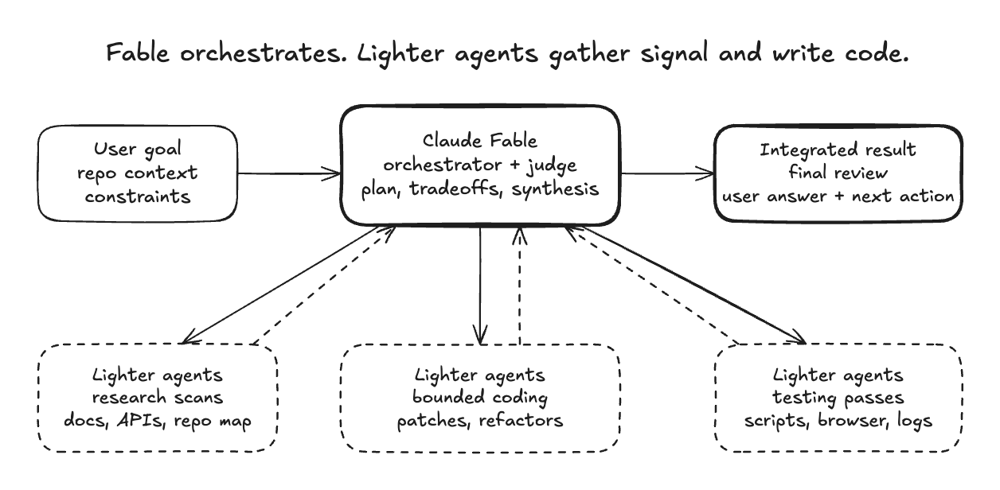

# /efficient-orchestrator

Spend the expensive model on judgment, and cheap agents on everything else.

When you're running a high-cost model (Claude Fable or Opus, OpenAI Astra or
Sol), `/efficient-orchestrator` keeps it on planning, tradeoffs, integration and
final review, and hands bounded research, coding, QA and log work to cheaper
subagents: Haiku or Sonnet under Claude, Terra or Luna under OpenAI.

<picture>
  <source media="(prefers-color-scheme: dark)" srcset="assets/fable-orchestrator-dark.png">
  <source media="(prefers-color-scheme: light)" srcset="assets/fable-orchestrator.png">
  
</picture>

## When it runs

Only when you invoke it by name. It never activates on its own, because
smarter models already reach for subagents readily, and unrequested fan-out
gets expensive fast. `/efficient-frontier` and `/efficient-fable` are aliases.

## What it does

- Picks the cheap helper tier that matches the main model, with the model and
  effort set explicitly on every spawn.
- Sends self-contained handoff packets with scope, verification and stop
  conditions.
- Caps helpers at 3–5 at a time; helpers never spawn helpers and are closed
  when done.
- Reviews the evidence that matters before claiming completion.
